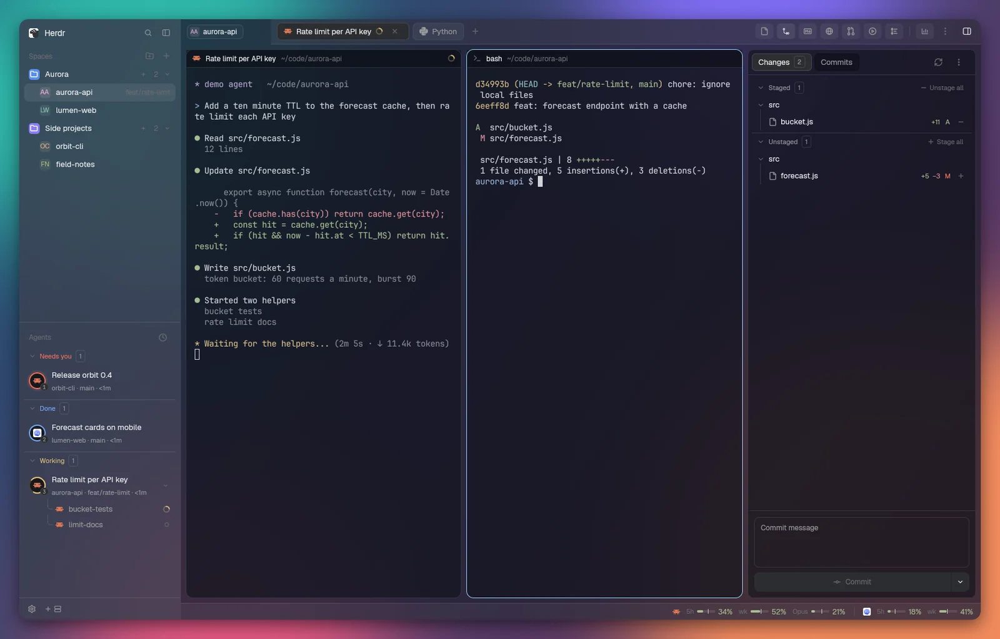
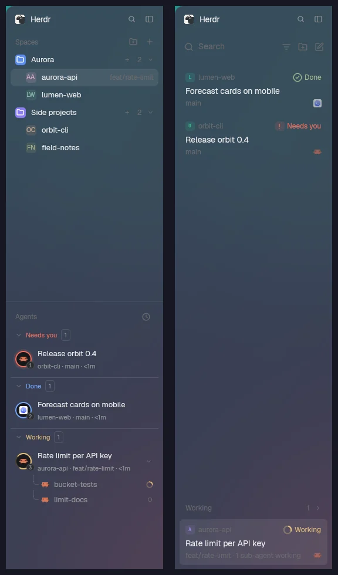
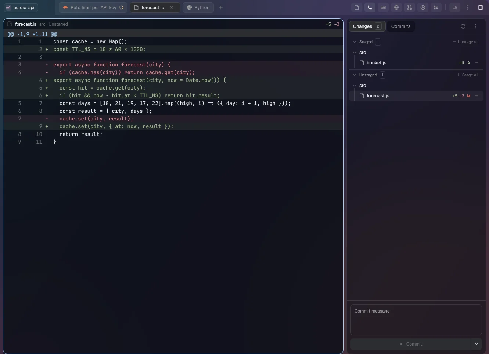
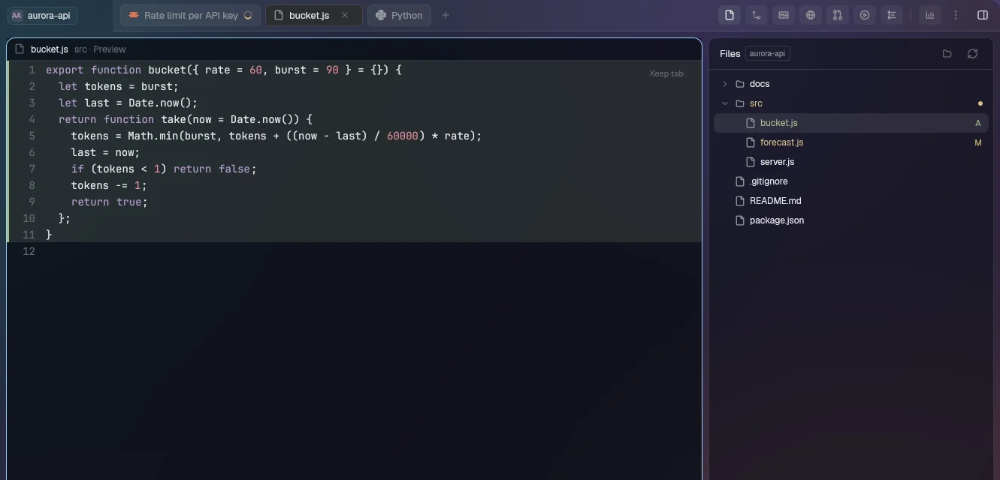
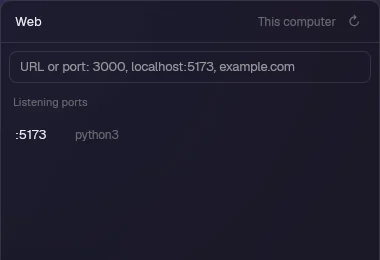
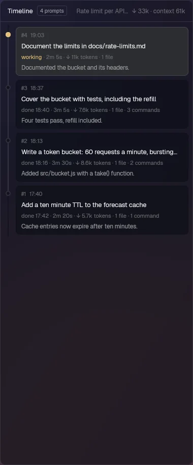
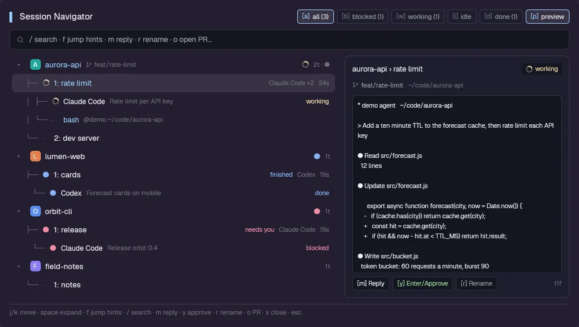
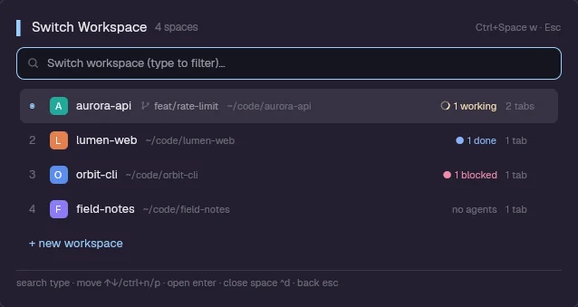

# herdr-glass

A translucent [Herdr App](https://github.com/herdrdev/herdr-app) layout for working with coding agents: spaces and agents on the left, files, diffs, pull requests and CI on the right, usage limits along the bottom.



The screenshots show made-up demo data in an isolated Herdr App on Linux, with the translucent window placed over a sample wallpaper. Blur behind the window depends on your system.

## Features

### Spaces, agents and Inbox

Group spaces into colored folders. Below them, agents are sorted into Needs you, Done, Working and Idle, with sub-agents nested under the agent that started them. `ctrl-space i` swaps the sidebar for an Inbox where you can settle or snooze agents.



The agents list and the Inbox are two views of one sidebar, shown side by side here.

### Changes

Stage, commit and amend, browse commit history, and open diffs inline or side by side. It does not fetch, pull, push or discard.



### Files

A read-only tree of the focused pane's folder with git status marks and a file viewer. Right-click a file to send its path and a prompt to an agent.



### Markdown

Lists the repository's Markdown files (outside a repository, those up to three folders deep) and the ones your terminal mentioned. Opens a rendered preview beside the pane, with a source view that can edit and save files on this machine.


### Web

Lists listening ports, leaving out those of agents and some other apps. Pick one, type a URL, or click a localhost link in a terminal to open it with [terminal-browser](https://terminal-browser.sh) in a pane beside your agent.



### Pull requests and CI

For GitHub, through `gh`. Read a pull request's description, comments and checks, then comment or merge. Watch Actions runs, rerun, cancel or dispatch them, and download artifacts.


The pull request and CI panels are shown side by side here; the app shows one at a time.

### Timeline

Your prompts to the focused Claude Code agent, each with its duration, output tokens, files changed and commands run.



### Usage limits

Claude and Codex rate-limit windows in the bottom bar; hover for reset times. OpenCode and Pi show token spend instead. Every five minutes the bar asks the `claude` and `codex` command line tools for these numbers, so install and sign in to the ones you want shown.


### Insights

A token dashboard built from Claude Code, Codex, OpenCode, Pi and Antigravity logs: daily history, streaks and top models. It counts tokens, not cost. With other machines connected, it also shows the Insights results cached on them.


### Vitals

In `glass` and `glass-insights`, the Vitals panel shows a card for this computer and each connected machine: CPU, memory, swap, the `/` disk and network, with graphs for CPU, memory and network, and the battery on a Mac. Hover a CPU row for the busiest processes.

### Resource alerts

In `glass` and `glass-insights`, the `fleet-resources` daemon checks this computer and every connected machine every 15 seconds, whether or not any panel is open. It notifies you in Herdr App and on the desktop of the computer you are looking at, so a spike on another machine does not go unseen.

| Alert | Raised when | Cleared when |
| --- | --- | --- |
| CPU | 90% or more for 2 minutes | below 75% for 1 minute |
| Memory, Linux | less than 10% available for 2 minutes | 15% or more available for 1 minute |
| Memory, macOS | memory pressure critical for 2 minutes | below critical for 1 minute |
| Disk, each one | 90% full or more for 30 seconds | below 87% for 1 minute |
| Not answering | no usable sample for 2 minutes, including a machine Herdr marks unavailable | 2 samples in a row succeed |

While the reading stays over the threshold, an alert repeats every 15 minutes (a disk once a day). A repeat, like the first notice, needs the reading to have stayed there for the time in the table, so a single spike sends nothing. A machine that stops answering is announced once per outage. Any alert that clears and returns within the repeat window, including a machine that answers again and goes silent, waits for the window to end. Restarting Herdr App or switching layouts does not repeat a notice sent within that window; after it, a problem that is still there is announced again. When an alert you were told about clears, an in-app notice says it recovered, unless a restart or layout switch came more than a repeat window after the notice. CPU and memory alerts name up to three of the processes using the most CPU, without their arguments; a machine with BusyBox `top` names none.

On macOS only critical memory pressure alerts: a busy Mac can sit at "warn" pressure with its swap nearly full as a matter of course. Swap use is included in memory alerts but never raises one on either system.

Disk alerts cover every writable local disk, while the Vitals panel shows only `/`. Read-only mounts, network and pseudo filesystems, `tmpfs` (except one mounted at `/tmp`) and overlays other than `/` are left out, and a Mac's APFS system volumes count once, as `/System/Volumes/Data`. For an APFS volume the percentage is its container's, which includes the other volumes in it, so it can be higher than the one `df` shows. A single mount cannot be excluded.

The daemon also publishes each machine's latest CPU, RAM and disk % in Herdr shared state, as `fleet-resources.readings`. The disk is `/`, or on a Mac `/System/Volumes/Data` where there is one; a read-only one has no figure. In `glass-insights`, once this computer has another machine added, the bottom bar shows them at its left edge, one pill for each machine on the bar, where there is room.

The daemon runs read-only commands (`uname`, `/proc` reads, `getconf`, `iostat`, `sysctl`, `vm_stat`, `df`, `mount`, `top`, `ps`) on every connected machine, installs nothing on them and needs no root. Machines that report a system other than Linux or macOS are ignored; one that cannot run `sh` reads as not answering. Alerts exist only while a Herdr App window with `glass` or `glass-insights` is open.

To change the defaults, add `props` to the `content` of the `fleet-resources-daemon` block in [your own copy of the layout](#customize), for example `"content": { "mod": "fleet-resources", "props": { "cpuPct": 95 } }`. An invalid value falls back to the default.

| Prop | Default | Meaning |
| --- | --- | --- |
| `intervalSec` | 15 | Seconds between checks, 5 or more |
| `cpuPct` | 90 | CPU use that raises an alert |
| `cpuClearPct` | 75 | CPU use below which it clears; never above `cpuPct` |
| `memAvailPct` | 10 | Linux: available memory below which it alerts; it clears 5 points higher |
| `diskPct` | 90 | Disk use that raises an alert; it clears more than 3 points lower |
| `holdSec` | 120 | How long CPU, memory or silence must last |
| `repeatMin` | 15 | Minutes between repeats; disks always wait 24 hours |
| `desktop` | `true` | Also send desktop notifications |

To turn it off, run `herdr-app do layout.hide --id fleet-resources-daemon` with the layout shown, in each layout you use, then restart Herdr App.

### Go to anything

`ctrl-space space` (or `ctrl-shift-k`) searches agents, panes, tabs and spaces, with a preview of the highlighted terminal.


### More

- `ctrl-space w` picks a space and `ctrl-space alt-t` shows the session tree.
- `ctrl-space ?` shows a cheat sheet of prefix keys. It does not list the keys specific to `glass`; see [`keys.fragment.json`](./keys.fragment.json).
- `ctrl-space r` shows every agent grouped by stage, with recaps for Claude Code sessions. Opening it downloads the [herdr-recap](https://github.com/mrolafsson/herdr-recap) program from its GitHub releases onto each machine running Claude Code, checks its checksum, runs it, and has it write out-of-date recaps by asking Claude under your account.
- On Linux, in `glass`, `glass-insights` and `omarchy-next`, a desktop notification tells you when an agent needs you or finishes.
- In `glass` and `glass-insights`, an idle agent has a blue status ring. For a visible unsent prompt in Claude Code or Codex, the ring turns gray and the agent moves ahead of empty idle agents in the sidebar and `ctrl-space ↑/↓` cycle. Detection may miss custom or unrecognized terminal layouts. Set `showDrafts` to `false` in the layout's agents block to turn it off.
- In `glass`, `glass-insights`, `omarchy` and `omarchy-next`, when a terminal on this machine comes back as a bare shell, for example after a restart, the pack types and runs the command that resumes its Claude Code session. This needs the `claude.session` terminal label, set by a statusline or hook that the pack does not ship. To turn it off, run `herdr-app do layout.hide --id agent-resume-daemon` with the layout shown, in each layout you use, then restart Herdr App.
- In `glass` and `glass-insights`, the **experimental** `quota-resume` daemon (**off by default**) watches Claude Code, Codex and OpenCode sessions running **on this machine** for rate-limit hits and, after the quota resets, types `"The usage limit has reset. Continue from where you left off."` and presses Enter into that agent terminal. Each Herdr App instance manages only its own local terminals, leaving remote fleet terminals to Herdr App on that machine so connected apps do not double-send. Automatic sends use `hc send --if idle` when a terminal reports `idle` (refusing `working` or `blocked`). For `done` or `error` terminals (where `hc send --if` is not available), sends are gated by pre-send `hc get` and screen draft checks without `--force`: `herdr-core` still refuses `blocked` terminals, but a `done` or `error` terminal that becomes `working` (or exits to a shell) while `herdr-core` holds delivery can still receive the prompt. Turn it on or off, choose which agents it covers, or cancel queued resumes in the **Insights** tab under **Quota auto-resume**, or hide the daemon with `herdr-app do layout.hide --id quota-resume-daemon` in each layout you use and restart Herdr App.
- Tabs name themselves after what runs in them. Read [what that sends](#what-tab-naming-does-and-sends).





## What tab naming does and sends

The `agent-names` mod runs in the background of the `glass`, `glass-insights`, `omarchy` and `omarchy-next` layouts.

**It also renames tabs you named.** Your name is passed along as a hint and may be replaced: right away for names that existed before the layout first loaded, after 10 minutes for names you type later. Tabs holding only idle shells that you have used keep your name. Unused ones on this machine are still marked and closed by tab cleanup, below, even if you named them.

**What it sends.** When a tab's panes change, usually at most once every 10 minutes per tab: the space name, any name you typed, and for each pane the program, status, session or terminal title (a shell's title can include your user name, host and path), current step, folder and branch. For up to two panes per tab that run an agent or report a status, and have no title or step, it also reads the last 40 lines on screen and sends up to 480 characters of each.

**Where it goes.** It tries these command line tools in order until one gives a usable name:

1. `agy` (a Gemini model)
2. `opencode`, with up to two of the free models listed in `~/.local/state/hierarchical-implementation/free-models.json`; skipped without that file
3. `claude` (Haiku)
4. for a tab on another machine, `claude` on that machine

Every tool it tries receives the text, even if its answer is not used, and passes it to that tool's provider under your account. If none gives a name, a local rule does. After an `agy` call the mod deletes that conversation's files when `agy` reports its id; otherwise they stay. `agy` keeps a summary entry either way. `claude` is run without saving a session, and the mod removes nothing that `opencode` stores.

**Tab cleanup.** The mod marks unused shell tabs on this machine (shells showing only their prompt) `· stale`, whether or not you named them. It closes them after 24 hours in a row with one of those layouts running, never the focused tab or a space's last one; a break of more than 15 minutes starts the count again. It logs closed tabs to `~/.local/state/herdr-tab-cleanup.log`.

**To turn it off**, which also stops the cleanup and the session titles in pane headers, run this with the layout shown, then restart Herdr App:

```bash
herdr-app do layout.hide --id agent-names-daemon
```

Repeat it in each layout you use (`glass`, `glass-insights`, `omarchy`, `omarchy-next`). `layout.show` with the same `--id` turns it back on.

Naming starts as soon as you switch to one of those layouts. For tab naming to send nothing from the start, delete the `agent-names-daemon` block from each of these layouts that you will use (`glass.json`, `glass-insights.json`, `omarchy.json`, `omarchy-next.json` in `~/.config/herdr-app/layouts/`) after installing and before switching to one. The installer then treats those files as edited and no longer updates them. Deleting the block also stops tab cleanup and the session titles in pane headers. Other calls continue: the usage bar still asks `claude` and `codex` for their limits, and opening recap still asks Claude.

## Install

Start Herdr App once, then:

```bash
git clone https://github.com/mdiloreto/herdr-glass.git && herdr-glass/scripts/install.sh --apply
```

Then switch to the layout:

```bash
herdr-app do layout.switch --name glass
```

On macOS, if `herdr-app` is not on your PATH, use `/Applications/Herdr.app/Contents/MacOS/Herdr`.

`--apply` installs the mods, layouts and themes, builds the pull request helper from source it fetches from `munza/herdr-mods` on GitHub at a pinned commit, and adds keybindings to `keys.json`: a `ctrl-space` prefix (press it twice to send it to the terminal) and a few others. It only adds bindings, keeps yours where they clash, and backs the file up first. It never installs programs, and never overwrites a mod, layout or theme that it did not install or that you edited. A layout file it installed and you deleted stays deleted on later runs and does not count as missing; copy it back from the checkout's `layouts/` to get it again. It lists what is missing or skipped and exits with status 1 while anything is.

| Option | Effect |
| --- | --- |
| none | Report only, write nothing |
| `--apply` | Install or update the pack |
| `--yes` | `--apply`, then install missing programs (uses sudo on Linux; for terminal-browser it may download and run its install script) |
| `--apply --no-keys` | Install and leave `keys.json` alone |
| `--apply --link` | Install the mods as symlinks to the checkout |

To update, run `git -C herdr-glass pull`, then `herdr-glass/scripts/install.sh --apply`. [`RECIPE.md`](./RECIPE.md) covers the other options and manual installation.

## Requirements

Herdr App 0.1.16 or later, on Linux or macOS. The installer reports most missing programs and how to get them. Check `curl` and `sqlite3` yourself, and on Linux also `lsof` and `setsid`.

| Program | Used for |
| --- | --- |
| `git` | Branches, changes and files |
| `gh`, signed in | Pull requests and CI |
| Node.js 22.15 or later | Installer and Insights |
| `python3` | Timeline, Codex session figures in the usage bar, image previews on Linux |
| `hc` | Usage limits (ships with Herdr App) |
| `claude`, `codex`, `opencode` (optional) | Usage bar, for the tools you use |
| `sqlite3` | OpenCode figures in the usage bar |
| `terminal-browser` | Web pages, on the machine that opens them. On Linux its installer may ask for extra system libraries |
| `lsof` on this machine, `ss` on remote Linux machines | The Web panel's port list |
| `notify-send`, `setsid` | Desktop notifications on Linux |
| `df`, `mount`, `top`, `ps`, and on macOS `iostat` and `vm_stat` | Resource alerts and Vitals, on each machine |
| `curl` | Recap, and terminal-browser's installer |
| Go | Building the pull request helper once |

## Customize

- **Layouts.** `glass-insights` is `glass` with a shorter sidebar footer. It also mounts the fleet quota bar, `usage-limits-fleet-canary`, in place of `usage-limits`; it shows quotas for every machine Herdr knows.
- **Themes.** The pack adds `omarchy` and `catppuccin`: `herdr-app do app.theme --name catppuccin`.
- **Your own copy.** `herdr-app do layout.clone --name glass --as my-glass`, then edit `layouts/my-glass.json` in `~/.config/herdr-app`: colors, gradient, `window_blur`, panel buttons. To keep the layout's own keys, copy the `layout:glass` section of `keys.json` to `layout:my-glass`.
- **Hide a block.** `herdr-app do layout.hide --id usage-limits`.
- **Keys.** [`keys.fragment.json`](./keys.fragment.json) lists every binding the pack adds. It also hands `ctrl-n` to the terminal program, so a `keys.json` that binds `ctrl-n` to the next agent no longer does that while a terminal has focus, and binds `ctrl-left` and `ctrl-right` to cycle the focused agent and its sub-agents. Your own bindings win. On Linux, Herdr App's default `keys.json` already binds both arrow keys in its `terminal` section to move by words, so inside a terminal they keep doing that. Where your `terminal` section does not bind them, the pack adds them there too, and terminal programs no longer get those keys. To cycle from a terminal too, set `ctrl-left` to `tui-prefix.prev-subagent` and `ctrl-right` to `tui-prefix.next-subagent` in the `terminal` section of `keys.json`; programs then no longer get those keys. The GitHub keys `ctrl-space alt-o` and `alt-p` need the Herdr terminal app with its `herdr-github` plugin.

Other layouts in the pack:

| Layout | What it is |
| --- | --- |
| `omarchy`, `omarchy-next` | Our opaque layouts. `omarchy` also needs the `fleet-quota` mod, which is not in the pack |
| `cockpit` | From [quaresc/cockpit](https://github.com/quaresc/cockpit), unchanged. It needs the separate [cockpit program](https://github.com/quaresc/cockpit#install), which the pack neither installs nor checks |
| `herdr-t3` | From [JinJieBeWater/herdr-t3](https://github.com/JinJieBeWater/herdr-t3), unchanged |
| `workspace` | From [tahadx/workspace](https://github.com/tahadx/workspace), unchanged |

## Develop

Check a mod with Herdr App, and run the pack's tests. One test checks that each program a mod names directly in an `exec()` call is in `requirements.json`; programs run through shell scripts or variables are not checked.

```bash
herdr-app check mods/<mod-name>
node --test tests/*.test.cjs
```

## Credits

Much of this pack is other people's work. [`PROVENANCE.md`](./PROVENANCE.md) records the sources, commits and changes.

| Source | What comes from it | License |
| --- | --- | --- |
| [munza/herdr-mods](https://github.com/munza/herdr-mods) | `better-alerts`, `better-changes`, `better-files`; our forks `better-tabs`, `branch-pr`, `better-sidebar-rail`, `rail-next` | Apache-2.0 |
| [JinJieBeWater/herdr-t3](https://github.com/JinJieBeWater/herdr-t3) | The `t3-*` mods, including the Inbox, and the `herdr-t3` layout; parts of `goto`, from its picker | Apache-2.0 |
| [tahadx/workspace](https://github.com/tahadx/workspace) | `agents-list`, `footer`, `hoverfocus`, `icons`, `shortcuts`, `sidebar-menu`, `terminals-list`, `worktrees`, and the `workspace` layout | MIT |
| [quaresc/cockpit](https://github.com/quaresc/cockpit) | The `cockpit` mod and layout, which bundle Apache-2.0 and MIT code and ISC [Lucide](https://github.com/lucide-icons/lucide) icons ([notices](./LICENSES/quaresc-cockpit.THIRD_PARTY_NOTICES.md)) | MIT and bundled licenses |
| [linziyanleo/herdr-mods](https://github.com/linziyanleo/herdr-mods) | our fork `preview-plus` ([notices](./mods/preview-plus/THIRD_PARTY.md)) | MIT and bundled licenses |
| [nozikov/herdr-usage-limits](https://github.com/nozikov/herdr-usage-limits) | `usage-limits`, whose panel icons upstream credits to [Lucide](https://github.com/lucide-icons/lucide) ([notice](./LICENSES/nozikov-herdr-usage-limits.lucide.txt)) | MIT; icons ISC |
| [mdiloreto/usage-insights](https://github.com/mdiloreto/usage-insights), a fork of [harshcurious/usage-insights](https://github.com/harshcurious/usage-insights) | `insights`, `usage-limits-fleet-canary` (derived from `nozikov/herdr-usage-limits`, MIT) | MIT |
| [dougcunha/herdr-mods](https://github.com/dougcunha/herdr-mods) | `ci-dash`, which bundles the ISC `yaml` library ([notice](./mods/ci-dash/yaml.LICENSE)) | MIT and ISC |
| [l4ci/herdr-mods](https://github.com/l4ci/herdr-mods) | `vitals`, whose panel design and macOS parsers come from [ozcberkay/herdr-coban](https://github.com/ozcberkay/herdr-coban) ([notice](./mods/vitals/NOTICE)) | Apache-2.0 |
| [ananjaemin/herdr-health-watch](https://github.com/ananjaemin/herdr-health-watch) | The model for the hold and recovery rules in `fleet-resources`; no code copied | MIT |
| [mrolafsson/herdr-recap](https://github.com/mrolafsson/herdr-recap) | `recap` | MIT |
| [herunan/herdr-over9k](https://github.com/herunan/herdr-over9k) | Our fork `over9k-prompts` (Timeline) | MIT |
| [ohneda/herdr-markdown-browser](https://github.com/ohneda/herdr-markdown-browser) | Our fork `markdown-browser` | MIT |
| [herdrdev/herdr-app](https://github.com/herdrdev/herdr-app) | Our forks `space-folders`, `space-folders-next`; the search scorer, match highlighting and status marks in `goto`, from its command palette and agents list; parts of `tui-goto` and `tui-spaces`, from its picker | Apache-2.0 |
| [Lucide](https://github.com/lucide-icons/lucide) | Icons in `goto` ([notice](./LICENSES/nozikov-herdr-usage-limits.lucide.txt)) | ISC; MIT for the Feather-derived ones |

## License

Original work is MIT, see [`LICENSE`](./LICENSE). Forked and vendored mods, and the third-party parts of `goto`, `tui-goto` and `tui-spaces`, keep their upstream licenses: see [`NOTICE`](./NOTICE) and [`LICENSES/`](./LICENSES/).
